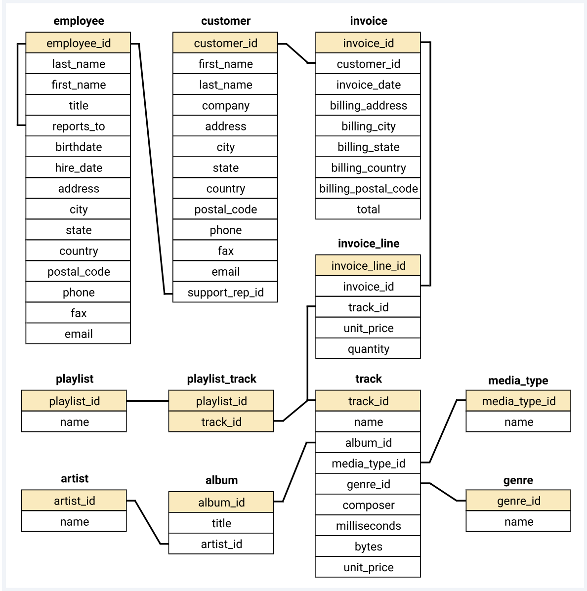

# 🎵 Music Store Analysis (SQL Project)

Analysis of a music store's relational database (Chinook-style schema) using **MySQL**, solving business questions across Basic, Moderate, and Advanced difficulty levels — including joins, subqueries, CTEs, window functions, and recursive queries.

## 📂 Project Structure

- `Music_Store_Analysis.sql` — All SQL queries (Basic → Advanced)
- `music_store.py` — Python script to load CSVs into MySQL
- `schema_diagram.png` — Database schema / ER diagram
- `Music Store Analysis-Questions.pdf` — Business questions solved
- `music store data/` — 11 raw CSV files (album, artist, customer, employee, genre, invoice, invoice_line, media_type, playlist, playlist_track, track)

## 🛠 Tools & Tech
- **MySQL** — database & querying
- **Python** (pandas, SQLAlchemy) — data ingestion pipeline
- **SQL concepts used:** Joins, Aggregations, Subqueries, CTEs, Window Functions (`ROW_NUMBER`), Recursive CTEs

## 🔄 Data Loading (Python → MySQL)
The raw data came as **11 separate CSV files**. Instead of importing each one manually, I wrote `music_store.py` to automate the process:
- Reads every CSV from the data folder using **pandas**
- Connects to MySQL via **SQLAlchemy**
- Loops through all 11 files and loads each one into its own MySQL table using `df.to_sql()`
- Prints a confirmation for each successful upload

This meant all 11 tables (album, artist, customer, employee, genre, invoice, invoice_line, media_type, playlist, playlist_track, track) were created and populated with a single script run — no manual CSV imports.

## 🔍 Business Questions Solved
**Basic**
- Most senior employee by job title
- Countries with the most invoices
- Top 3 invoice values
- City with highest total sales
- Best (highest-spending) customer

**Moderate**
- Rock music listeners (email, name, genre)
- Top 10 rock bands by track count
- Tracks longer than average song length

**Advanced**
- Amount spent by each customer on the best-selling artist
- Most popular genre per country
- Top-spending customer per country

Full solutions with query logic: [`Music_Store_Analysis.sql`](./Music_Store_Analysis.sql)

## ▶️ How to Run
1. Create a MySQL database named `music_database`.
2. Set your MySQL password as an environment variable (or the script will prompt for it):
   export MYSQL_PASSWORD=your_password   # Windows: set MYSQL_PASSWORD=your_password
3. Run `music_store.py` to load all 11 CSVs into MySQL tables.
4. Run the queries in `Music_Store_Analysis.sql`.

## 📊 Schema

---
*Project by Nidhi Gupta*
